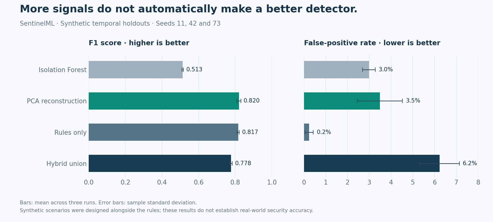
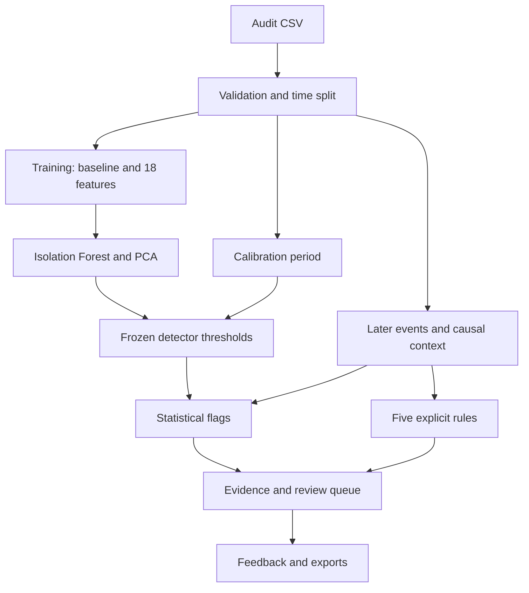

<div align="center">

# SentinelML
### Explainable anomaly detection for cloud audit logs

**Historical baselines. Reproducible evaluation. Evidence for every flag.**

Python · scikit-learn · Streamlit · Plotly · SQLite

[Quick start](#quick-start) · [Research results](#research-results) · [Architecture](docs/ARCHITECTURE.md) · [Application guide](docs/MASTERS_APPLICATION.md)

</div>

---

SentinelML is a local research prototype for investigating unusual cloud audit activity. It combines Isolation Forest, PCA reconstruction error and five explicit rules, then exposes the evidence in an interactive review dashboard.

The project explores a practical question: **does combining statistical anomaly detection with contextual rules improve the trade-off between detection coverage and analyst workload?** The included experiments compare the individual detectors with their union, using a chronological training/calibration/test split and synthetic scenarios with both benign changes and difficult anomalies.

> **Scope:** this is a portfolio research project, not a deployed security product. All bundled events and benchmark results are synthetic. It does not claim real-world attack-detection accuracy.

## Quick start

Use **Python 3.12** (3.11 is also included in the CI configuration). From this folder:

```bash
python -m venv .venv
```

Activate the environment:

```powershell
# Windows PowerShell
.venv\Scripts\Activate.ps1
```

```bash
# macOS / Linux
source .venv/bin/activate
```

Then install and launch:

```bash
python -m pip install -r requirements.txt
python -m streamlit run app.py
```

Open **http://localhost:8501**. The synthetic demo trains a small local model on first use and opens a complete investigation workspace. No API key, TensorFlow installation or pretrained binary is required.

If PowerShell blocks activation, use `.venv\Scripts\python.exe -m pip install -r requirements.txt`, followed by `.venv\Scripts\python.exe -m streamlit run app.py`; no policy change is necessary.

## What you can demonstrate

| Capability | Implemented behavior |
|---|---|
| Activity overview | Whole-batch KPIs, time trends, detector signals and a priority queue |
| Event investigation | Search, severity filters, fixed thresholds, observed context and suggested review steps |
| Analyst feedback | Local SQLite records scoped to event ID and model revision; repeat reviews update the record |
| Reproducible experiments | Four detector variants, chronological holdout, confusion matrices, average precision and three-seed comparison |
| Data quality | Required-field validation, UTC timestamps, duplicate-ID rejection, duplicate-payload warnings and upload limits |
| Reports | Complete scored CSV, diagnostics JSON and printable HTML; browser printing supports PDF |
| Engineering checks | Automated regression tests, linting, formatting, pinned direct dependencies and GitHub Actions configuration |

## Research results

The bundled seed-42 dataset contains **7,872 synthetic events**: 4,463 training, 1,517 calibration and 1,892 test events. The test period includes 372 scenario-anomaly events. Splits use **60% / 20% / 20% of elapsed time**, not row counts.

| Detector | Precision | Recall | F1 | False-positive rate |
|---|---:|---:|---:|---:|
| Isolation Forest | 0.742 | 0.387 | 0.509 | 3.29% |
| PCA reconstruction | 0.837 | 0.828 | 0.832 | 3.95% |
| Rules only | 0.992 | 0.702 | 0.822 | 0.13% |
| Hybrid union | 0.746 | 0.828 | 0.785 | 6.91% |

**Finding:** the hybrid union matches PCA recall but increases false positives in this run. Across seeds 11, 42 and 73, PCA has mean F1 **0.820**, compared with **0.778** for the hybrid union. The system exposes the union as a broad review queue; the evidence does **not** justify calling it the best classifier. The intentionally difficult low-and-slow scenario has only **1 of 36 events** detected by the hybrid in seed 42.

These results are an engineering benchmark of deliberately generated patterns. They are not external validation. Scenario events are correlated, and the generator was designed alongside the rules. Do not describe these figures as production accuracy or confirmed attack detection.

Full outputs: [single run](reports/reference/evaluation.md), [machine-readable report](reports/reference/evaluation.json), [three-seed metrics](reports/benchmark/seed_metrics.csv), [research note](docs/RESEARCH_NOTE.md).



## Reproduce the experiments

```bash
# Generate the complete synthetic dataset, train, calibrate and evaluate.
python -m sentinel demo --output artifacts/demo

# Repeat the comparison across three independent generator/model seeds.
python -m sentinel benchmark --output artifacts/benchmark

# Evaluate your own labeled dataset (label must be 0 or 1).
python -m sentinel evaluate data/private/labeled_events.csv
```

To regenerate the comparison figure, install `requirements-analysis.txt` and run `python scripts/plot_benchmark.py`.

Generated artifacts go into the ignored `artifacts/` folder. The reference JSON contains split dates, configuration, dataset hashes, environment versions, thresholds and confusion counts. Timing values depend on the machine and are not portable performance guarantees.

## Use your own audit logs

The dashboard's **Your audit logs** workspace accepts a historical baseline CSV followed by a separate, later event CSV. Keep the raw files outside the repository or in ignored `data/private/`.

```bash
python -m sentinel train data/private/history.csv --output artifacts/my_detector.joblib
python -m sentinel score data/private/later_events.csv --model artifacts/my_detector.joblib --output artifacts/review
```

The train command uses the first 60% of the historical time range to fit models, the next 20% to calibrate thresholds, and leaves the final 20% unused as a holdout. It does not filter by labels. Choose a representative, mostly benign baseline. The score command accepts any time range but reports temporal overlap; overlapping data is not an independent test.

Required columns: `event_time`, `event_name`, `principal_name`. Optional context: `ip_address`, `response_status`, `source_service`, `auth_type`, `resource_name`, `opc_client_info`, `compartment_name`. See [the data contract](docs/DATA_CONTRACT.md).

## Detection method



Learned frequencies, principal context, scaling and model fitting use training data only. Thresholds use a separate calibration distribution and remain fixed at inference. Ten-minute counts use previous/current events, with no future-event counts or wall-clock dependence. Context resets at batch boundaries. Explanations are deterministic descriptions of signals and observations, not LLM output or causal feature attributions.

## Development

```bash
python -m pip install -r requirements-dev.txt
python -m pytest -q
ruff check .
ruff format --check .
```

See [VALIDATION.md](docs/VALIDATION.md) for checks actually executed and limitations. The CI workflow is included; a successful hosted CI run is not claimed until you push the project and run it.

The app is intended for local, trusted single-user investigation. Before any public or shared deployment, add authentication, authorization, storage isolation, operational monitoring and an independent security review. Analyst feedback is stored locally in SQLite; protect that file as operational data.

## Project map

| Location | Purpose |
|---|---|
| `app.py` | Streamlit investigation dashboard |
| `sentinel/schema.py` | Shared CSV validation and normalization |
| `sentinel/features.py` | Historical profiles and causal context features |
| `sentinel/model.py` | Fitting, fixed calibration, scoring and metadata |
| `sentinel/rules.py` | Explicit, inspectable rule definitions |
| `sentinel/evaluation.py` | Time splits, ablations and seeded experiments |
| `sentinel/demo.py` | Entirely synthetic data generator |
| `sentinel/feedback.py`, `export.py` | Analyst review and portable outputs |
| `tests/` | Behavioral regression checks |
| `docs/` | Architecture, research note, original-project audit and application guidance |
| `data/demo/` | Reproducible synthetic CSV and provenance manifest |
| `reports/` | Executed reference results |

## From the original prototype

Version 2 preserves the audit-log investigation concept and Streamlit interface while replacing the duplicated inference paths, upload-relative thresholds, stale cache behavior and incomplete reporting workflow. The TensorFlow autoencoder is replaced by a lightweight PCA reconstruction baseline. Unvalidated supervised models and the remote chatbot are removed from the supported feature set. Original log files, model binaries, secrets and accumulated reports are not redistributed. See [the detailed audit](docs/PROJECT_AUDIT.md).


